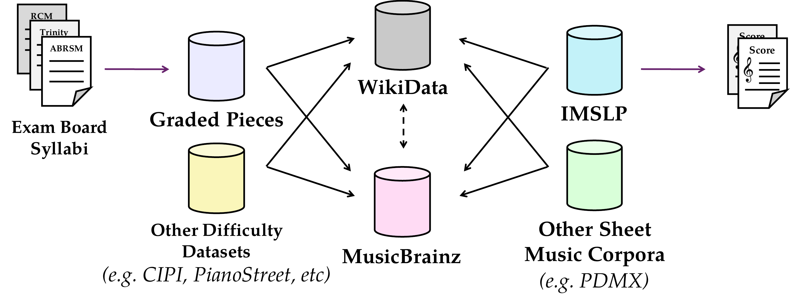

# MetaMatch: Reconciling Metadata for Aggregating Music Difficulty Annotations

[Project page](https://meganelisabethfinch.github.io/metamatch) · [Paper](deliverables/metamatch_paper.pdf) · [Poster](deliverables/metamatch_poster_landscape.pdf)

Code for the ISMIR 2026 paper *MetaMatch: Reconciling Metadata for Aggregating Music Difficulty Annotations*. 



## Citation

```bibtex
@inproceedings{finch2026:metamatch,
  author    = {Finch, Megan E. and Willcocks, Chris G. and Gotham, Mark R. H.},
  title     = {{MetaMatch}: Reconciling Metadata for Aggregating Music Difficulty Annotations},
  booktitle = {Proceedings of the 27th International Society for Music Information Retrieval Conference (ISMIR)},
  address   = {Abu Dhabi, UAE},
  year      = {2026}
}
```
